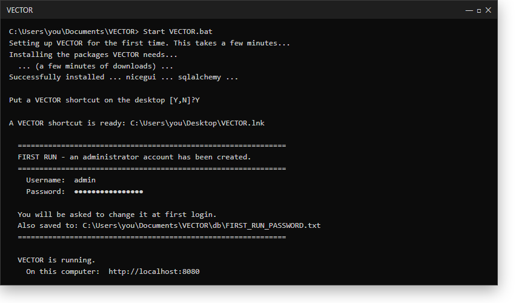
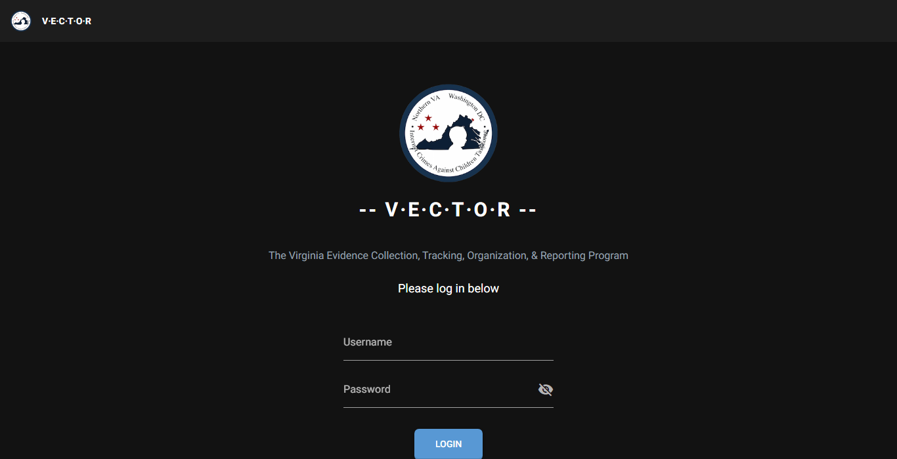
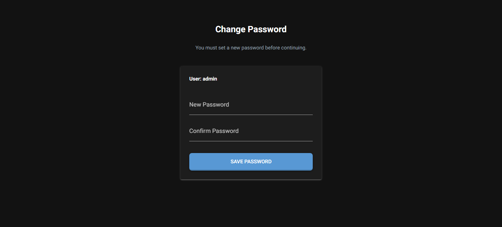
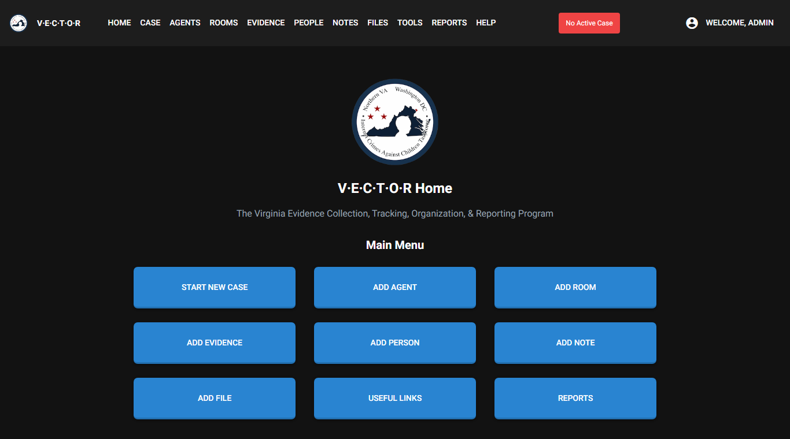
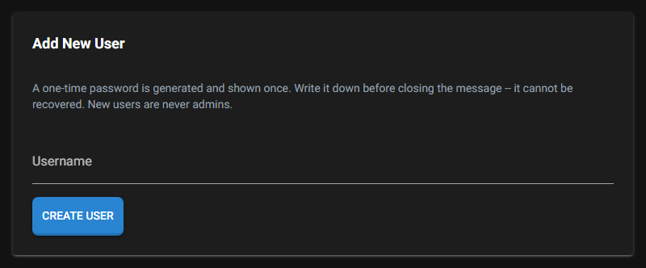
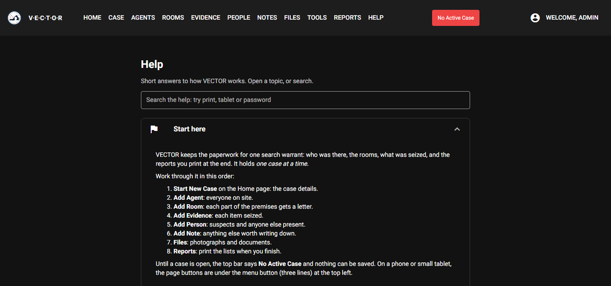
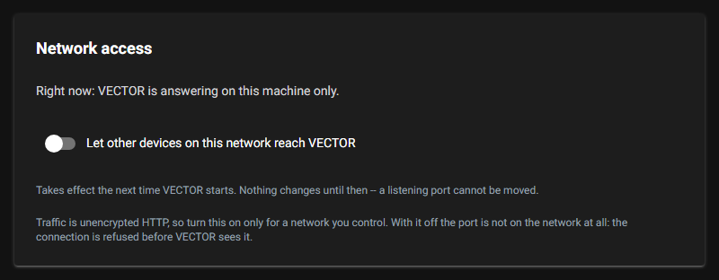

# Installing VECTOR

**You are in the right place.** This folder has everything you need to
install VECTOR and start it:

| In this folder | What it is |
|---|---|
| **VECTOR install guide.pdf** | This guide, with pictures, to read or print |
| **Start VECTOR (Windows).bat** | Double-click to start VECTOR on Windows |
| **Start VECTOR (Mac).command** | Double-click to start VECTOR on a Mac |
| README.md | This guide, as text |

The rest of the VECTOR folder is the program itself. You do not need to
open anything else.

It takes about fifteen minutes, once per laptop.

**Contents**

- [What you need](#what-you-need)
- [1. Install Python](#1-install-python)
- [2. Get VECTOR](#2-get-vector)
- [3. Start VECTOR](#3-start-vector)
- [4. Sign in the first time](#4-sign-in-the-first-time)
- [5. Add your team](#5-add-your-team)
- [6. The desktop shortcut](#6-the-desktop-shortcut)
- [Every day](#every-day)
- [Using tablets](#using-tablets)
- [Updating to a new version](#updating-to-a-new-version)
- [Where your data is](#where-your-data-is)
- [If VECTOR does not start](#if-vector-does-not-start)
- [Removing VECTOR](#removing-vector)

---

## What you need

- A laptop running **Windows 10 or 11**, or a **Mac with macOS 11
  (Big Sur) or newer**. Linux works too; see
  [the reference](../docs/REFERENCE.md#requirements).
- About **200 MB** of free space.
- An **internet connection the first time** VECTOR starts. After that it
  runs without one.
- Permission to install programs. On an agency laptop you may need IT to
  do step 1.

---

## 1. Install Python

VECTOR is written in Python, so the laptop needs Python 3.10 or newer.

### Windows

1. Go to <https://www.python.org/downloads/> and press the yellow
   **Download Python** button.
2. Open the file you downloaded.
3. **On the first screen, tick "Add python.exe to PATH"** at the bottom.
   This is the step people miss. Without it VECTOR cannot find Python.
4. Press **Install Now**, and **Close** when it finishes.

### Mac

1. Go to <https://www.python.org/downloads/> and press **Download Python**.
2. Open the `.pkg` file you downloaded and press **Continue** through each
   screen, then **Install**.

---

## 2. Get VECTOR

1. On the VECTOR GitHub page, press the green **Code** button, then
   **Download ZIP**.
2. Unzip it into a folder you will keep, such as `Documents\VECTOR` on
   Windows or `Documents/VECTOR` on a Mac.
   - On Windows: right-click the ZIP, **Extract All**, choose the folder.
   - On a Mac: double-click the ZIP, then move the folder it makes.
3. Open the folder, then **00 START HERE**: this folder.

Do not run VECTOR from inside the ZIP, or from the Downloads folder: the
case is saved inside the VECTOR folder, so put it somewhere it will stay.

---

## 3. Start VECTOR

### Windows

Double-click **Start VECTOR (Windows).bat** in this folder.

If Windows says **"Windows protected your PC"**, press **More info**, then
**Run anyway**. It says this about any file downloaded from the internet.

### Mac

Double-click **Start VECTOR (Mac).command** in this folder.

If the Mac says it **cannot be opened because it is from an unidentified
developer**: right-click it, choose **Open**, then **Open** again. On newer
Macs you may need **System Settings → Privacy & Security → Open Anyway**
instead.

### The first start

A window opens and sets VECTOR up. It downloads what VECTOR needs, which
takes a few minutes, then asks whether to put a shortcut on the desktop:
press **Y** (see [step 6](#6-the-desktop-shortcut)). Then your web browser
opens on the VECTOR sign-in page.



*The VECTOR window on the first start. The password is hidden in this
picture, and the folder names will be your own.*

**Keep that window open** while you use VECTOR. Closing it stops VECTOR.

---

## 4. Sign in the first time

1. The VECTOR window shows a username, **admin**, and a one-time
   password. The same is saved in the file `db\FIRST_RUN_PASSWORD.txt`
   in the VECTOR folder, in case the window scrolls.
2. Sign in with them.

   

3. VECTOR asks you to choose your own password. Type it twice and press
   **Save Password**.

   

4. **Delete `FIRST_RUN_PASSWORD.txt`** from the `db` folder.

You are now on VECTOR's Home page:



---

## 5. Add your team

Give each agent their own account, so the audit trail shows who did what.

1. Open the account menu at the top right (**Welcome, admin**), then
   **Admin Panel**.
2. Type a username and press **Create User**.

   

3. VECTOR shows a one-time password **once**. Write it down and give it to
   the agent. They choose their own the first time they sign in.

New accounts are never administrators.

---

## 6. The desktop shortcut

The first time VECTOR starts, it asks **"Put a VECTOR shortcut on the
desktop?"**. Press **Y**, or wait 30 seconds, and a VECTOR shortcut with
VECTOR's own icon appears on the desktop:


*On a Windows desktop. On a Mac it is a small VECTOR app on the desktop,
with the same icon; drag it to the Dock to keep it there.*

From then on, double-click the shortcut to start VECTOR.

**Said no, or moved the VECTOR folder?** Make the shortcut again. Open
Command Prompt (Windows) or Terminal (Mac) in the VECTOR folder and run:

```
.venv\Scripts\python tools\make_shortcut.py
```

On a Mac: `.venv/bin/python tools/make_shortcut.py`

If a work laptop does not allow it, the message says how to make the
shortcut by hand.

---

## Every day

- **Start:** double-click the VECTOR shortcut. Your browser opens on the
  sign-in page.
- **Stop:** close the VECTOR window. An administrator can also choose
  **Shutdown** from the account menu.
- **Help:** the **Help** page in VECTOR's top bar explains each page in
  short steps, with a search box.

  

---

## Using tablets

Tablets and other laptops can use VECTOR over the same Wi-Fi:

1. An administrator turns on **Let other devices on this network reach
   VECTOR** in the **Admin Panel**.

   

2. Close the VECTOR window and start VECTOR again.
3. The first time, Windows asks whether to allow Python on the network.
   Allow it on **private networks** only. A Mac asks whether to accept
   incoming connections: allow it.
4. On the VECTOR laptop, open **Help → Connect a Device**. Type the address
   it shows, such as `http://192.168.1.23:8080`, into the tablet's browser.

The connection is not encrypted. Use a network you control, such as your
own hotspot, not a hotel's or the venue's Wi-Fi.

---

## Updating to a new version

1. Download and unzip the new version into a **new** folder.
2. From the old VECTOR folder, copy across:
   - the **`db`** folder: your cases, accounts and settings;
   - **`parts\agents.json`**: the agents remembered between searches.
3. Start VECTOR from the new folder. The first start installs anything new,
   so it needs the internet once. It also offers a new desktop shortcut:
   press **Y**, so the shortcut opens the new folder.
4. When everything looks right, delete the old folder.

If you use `git`: close VECTOR, run `git pull`, and start it again.

---

## Where your data is

Everything about your cases is in the **`db`** folder inside the VECTOR
folder: the case, the attachments, the accounts and the audit trail.

- **Treat it as evidence.** Anyone who copies it can read the case, unless
  you have turned on database encryption (see
  [the reference](../docs/REFERENCE.md#encrypting-the-case-database)).
- **To back it up**, close VECTOR and copy the whole `db` folder.
- **Never delete** the files ending in `-wal` or `-shm`. They hold the most
  recent changes.

---

## If VECTOR does not start

**"Python 3.10 or newer is needed"**: Python is not installed, or on
Windows the **"Add python.exe to PATH"** box was not ticked. Run the Python
installer again, tick it, and start VECTOR again.

**"Installing the packages failed"**: the internet connection dropped, or a
work network blocked the download. Start VECTOR again; it carries on where
it stopped.

**The window opens and closes at once**: open Command Prompt (or Terminal
on a Mac) in this folder and start it from there, so the message stays on
screen:

```
"Start VECTOR (Windows).bat"
```

On a Mac: `./"Start VECTOR (Mac).command"`

**The browser did not open**: open it yourself and go to
<http://localhost:8080>.

**An error about port 8080, or "address already in use"**: VECTOR is
already running in another window, or another program is using the port.
Close the other VECTOR window first.

**Windows or the Mac will not run the file**: see the warnings in
[step 3](#3-start-vector).

**Mac: "permission denied"**: in Terminal, in the VECTOR folder, run once:
`chmod +x "Start VECTOR.command" "Start VECTOR.sh" "00 START HERE/Start VECTOR (Mac).command"`

**Forgot the admin password**: if another administrator can sign in, they
can press **Reset** next to the account in the **Admin Panel**. If nobody
can: close VECTOR, move the three files `users.db`, `users.db-wal` and
`users.db-shm` out of the `db` folder, and start VECTOR again. With no
accounts it creates a new `admin` with a one-time password, as on the
first start. The case is untouched; other accounts need adding again.

Anything else: [the reference](../docs/REFERENCE.md#troubleshooting) has
the full list.

---

## Removing VECTOR

1. Export any case you need (**Export Case Data** on the Home page), and
   keep a copy of the `db` folder if your policy says to.
2. Delete the VECTOR folder, and the VECTOR shortcut on the desktop.
3. Python can stay, or be removed from **Settings → Apps** (Windows) or by
   deleting it from **Applications** (Mac).
